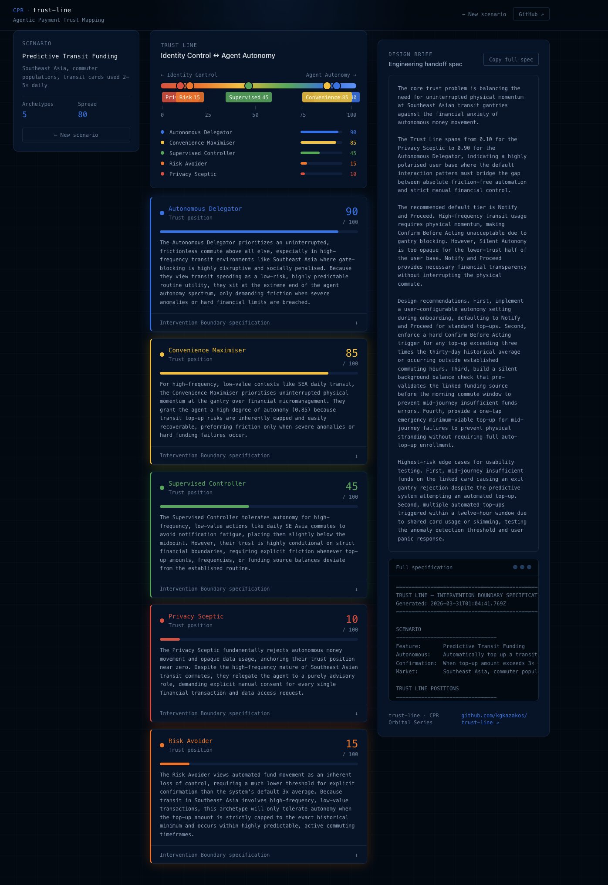

# trust-line

**Agentic Payment Trust Mapping** — a Computational Prototyping tool that maps the Trust Line for autonomous payment feature decisions.

Input a payment feature scenario. Simulate how five user archetypes respond across the Identity Control ↔ Agent Autonomy spectrum. Receive an Intervention Boundary specification and design brief your engineers can act on directly.



**Live demo:** [trust-line-theta.vercel.app](https://trust-line-theta.vercel.app/)

---

## What it does

UX teams spend weeks trying to answer one question before shipping agentic features: *when should the AI act silently, and when should it ask?*

trust-line answers it in minutes.

For any autonomous payment feature you define, it simulates five behaviorally-grounded user archetypes:

| Archetype | Trust tendency |
|---|---|
| **Autonomous Delegator** | Comfortable with agents acting for routine financial tasks |
| **Convenience Maximiser** | Prioritises frictionlessness; tolerates autonomy if errors are recoverable |
| **Supervised Controller** | Wants visibility above personal thresholds; trust earned incrementally |
| **Privacy Sceptic** | Wants explicit consent at each autonomous step regardless of amount |
| **Risk Avoider** | Treats all financial decisions as high-stakes; defaults to confirmation |

For each archetype, the tool generates a three-tier **Intervention Boundary**:

```
SILENT AUTONOMY      — acts without notification when: …
NOTIFY AND PROCEED   — acts but notifies when: …
CONFIRM BEFORE ACTING — pauses for explicit confirmation when: …
```

This output format maps directly to what a UX Engineer or designer needs to spec agent interaction patterns.

---

## Stack

- **Next.js 14** (App Router, TypeScript strict mode)
- **Gemini 4 Argon** via `@google/genai` — server-side only, API key never touches the client bundle
- **Tailwind CSS** — dark navy / Google blue payments aesthetic
- **Recharts** — Trust Line spectrum visualisation
- Streaming responses — each archetype streams sequentially, Trust Line builds in real time

---

## Local setup

```bash
# 1. Clone
git clone https://github.com/kgkazakos/trust-line.git
cd trust-line

# 2. Install dependencies
npm install

# 3. Add your Gemini API key
cp .env.local.example .env.local
# Edit .env.local and set GEMINI_API_KEY=your_key_here
# Get a key at: https://aistudio.google.com/app/apikey

# 4. Run
npm run dev
```

Open [http://localhost:3000](http://localhost:3000).

---

## Deploying to Vercel

```bash
# Install Vercel CLI
npm i -g vercel

# Deploy
vercel

# Set the environment variable in the Vercel dashboard:
# Project Settings → Environment Variables → GEMINI_API_KEY
```

Or connect the GitHub repo directly in the Vercel dashboard and set `GEMINI_API_KEY` in project settings. The API key is consumed server-side only and never included in the client bundle.

---

## Architecture

```
trust-line/
├── app/
│   ├── page.tsx                    # Main UI — scenario input, simulation state, results
│   ├── layout.tsx                  # Metadata, font imports
│   ├── globals.css                 # DM Mono + DM Sans, dark navy theme, trust gradient
│   └── api/simulate/route.ts       # Server-side Gemini API — streaming SSE, never client-exposed
├── components/
│   ├── ScenarioForm.tsx            # Payment feature input with validation
│   ├── ArchetypeSelector.tsx       # Archetype selection with colour-coded toggles
│   ├── TrustLineChart.tsx          # Horizontal spectrum with archetype markers
│   ├── ArchetypeCard.tsx           # Individual result with expandable boundary spec
│   ├── InterventionBoundary.tsx    # Three-tier Silent / Notify / Confirm display
│   ├── DesignBrief.tsx             # Copyable full spec in terminal style
│   └── LoadingState.tsx            # Progressive per-archetype streaming indicator
├── lib/
│   ├── prompts.ts                  # All prompts separated — zero inline strings
│   ├── archetypes.ts               # Archetype definitions, colours, default positions
│   └── types.ts                    # TypeScript interfaces — strict, zero any
└── .env.local.example              # GEMINI_API_KEY placeholder
```

**Security:**
- `GEMINI_API_KEY` is read only in `app/api/simulate/route.ts` (Node.js server runtime)
- No API key is included in the client bundle under any condition
- `.env.local` is in `.gitignore`

---

## Part of the CPR Ecosystem

trust-line is a **Computational Prototyping** tool — part of the Computational Product Research (CPR) discipline developed by [Kostas Kazakos](https://github.com/kgkazakos).

Related projects:
- **[CausalTrack](https://github.com/kgkazakos/CausalTrack)** — Multimodal Say-Do Gap detection (Gemini + Neo4j), targeting CHI 2027
- **[Synthetic User Council](https://github.com/kgkazakos/synthetic-user-council)** — Agent-led ecosystem simulation, targeting CHI 2027
- **CPR Orbital** — 40 open-source research tools shipping every Friday, Mar–Dec 2026

---

## License

MIT © 2026 Kostas Kazakos
